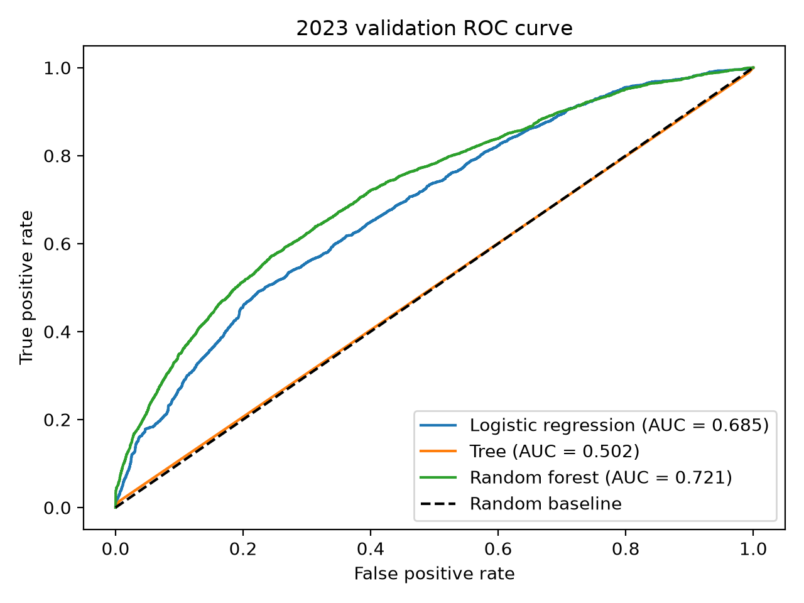

# SUS: Screening Unverified Speedruns

Cost sensitive machine learning for prioritizing human review of speedrun submissions.

**Lily Holmes · CSCI 5622: Machine Learning · Fall 2026**

## Decision and data

The model sends some runs to priority review; others stay in the normal queue. It never approves or rejects a run. A positive label means **historically rejected**, which does not prove cheating.

Data comes from the [Kaggle Speedrun.com dataset](https://www.kaggle.com/datasets/alexmerren1/speedrun-com-data). Cleaning keeps resolved runs dated 2018–2024 from games selected using pre-2021 activity. Outcome fields such as `statusReason`, `verifiedDate`, and `examiner` are excluded from predictors.

## Evaluation

| Split         | Years      | Purpose                      |
| ------------- | ---------- | ---------------------------- |
| `train`     | 2018–2020 | Fit models and preprocessing |
| `tune`      | 2021       | Choose hyperparameters       |
| `threshold` | 2022       | Choose review thresholds     |
| `selection` | 2023       | Compare and select a model   |
| `test`      | 2024       | Final evaluation             |

The primary metric is **cost per 1,000 runs**: `1,000 × (false positives + 2 × false negatives) / runs`. The 2:1 penalty is an assumption. Logistic regression, a decision tree, and a random forest compete on 2023 cost; the selected model and threshold are saved in `outputs/selected_model_2023.json`.



## Reproduce the results

Run from the repository root:

```bash
python -m pip install -r requirements.txt
python pipeline.py
python src/report_model_choices.py
```

`pipeline.py` downloads raw data when absent (Kaggle CLI and credentials required), cleans and splits it, tunes models, selects the 2023 winner, evaluates 2024, and runs the isolation forest, cost sensitivity, error slice, and hybrid escalation analyses. The last command derives `outputs/model_choices.txt` from the saved 2023 selection and 2021 parameter files.

For individual reruns after the data splits exist:

| Command                                                            | Result                                                                                   |
| ------------------------------------------------------------------ | ---------------------------------------------------------------------------------------- |
| `python pipeline/03_run_models.py`                               | 2023 model choice, threshold tables, confusion matrices, ROC and precision–recall plots |
| `python pipeline/05_test_2024.py`                                | Prints 2024 holdout results                                                              |
| `python pipeline/07_isolation_pca_2d.py`                         | Isolation forest scores and PCA plot                                                     |
| `python pipeline/08_cost_sensitivity.py`                         | 2:1, 5:1, and 10:1 cost comparison CSV                                                   |
| `python pipeline/09_error_analysis.py`                           | 2024 game and developer error slice CSVs                                                 |
| `python pipeline/10_hybrid_anomaly_escalation.py`                | Supervised versus anomaly escalation CSV                                                 |
| `python pipeline/04_gmm.py` and `python pipeline/06_gmm_2d.py` | Optional GMM threshold study and two feature plot                                        |
| `python src/split_summary.py`                                    | Split sizes and rejection rates CSV                                                      |

## The requirements

1. **R1 — A decision, not a dataset.**

   - Moderators decide which runs receive priority human review. An unnecessary review costs 1; a missed rejection costs 2.
   - `08_cost_sensitivity.py` checks how that decision changes when missed rejections cost 5 or 10.
2. **R2 — A baseline declared before you modeled.**

   - The [revised proposal](logs/proposal.md) declares review none as the baseline and review all as a second reference.
   - On 2023 runs, the selected forest cost 147.78 per 1,000 versus 149.38 for review none.
3. **R3 — Two models across the interpretability axis.**

   - `03_run_models.py` compares readable logistic regression and a decision tree with a flexible random forest on the same split and cost metric.
   - The forest won the 2023 comparison at threshold 0.4; `05_test_2024.py` evaluates that saved choice on 2024 runs.
4. **R4 — Unsupervised structure where it changes the decision.**

   - The GMM and isolation forest scripts test anomaly review rules. `10_hybrid_anomaly_escalation.py` checks whether isolation forest flags improve supervised review.
   - For the forest, escalation raised 2024 cost from 133.69 to 134.32 per 1,000 in that separate analysis, so it did not earn a place in the selected rule.
5. **R5 — A failure analysis with a named worst slice.**

   - `09_error_analysis.py` reports 2024 game and developer slices with sample sizes and 95% intervals.
   - Among games with at least 100 runs, Grand Theft Auto Category Extensions had the largest cost increase over review none: 208 per 1,000 across 250 runs.
6. **R6 — A recommendation, and the fact that would reverse it.**

   - I would carefuly deploy the random forest, with model review often
   - If interpreability was needed for legal or stakeholder reasons, then the model would not fit that requirement.

## Limits and project record

The run `date` may differ from submission time, so the split tests later **dated** runs. Rejection is not a cheating label. The 2:1 costs are assumed, and the dataset license still needs verification. Expanding year validation, calibration, expected cost, and PCA with LDA from the proposal remain unimplemented. The 2024 error slice and hybrid scripts are follow-up analyses, not part of the frozen 2023 model selection.

Basic repository structure:

```text
pipeline.py       Main reproducibility entry point
pipeline/         Download, cleaning, modeling, and analysis scripts
src/              Shared preprocessing, models, plots, and reports
data/             Local raw, cleaned, and year split CSVs
outputs/          Saved choices, tables, and figures
logs/             Proposal and AI use note
decision_log.md   Project decisions
```

See the [decision log](decision_log.md) and [AI use note](logs/ai_note.md).
